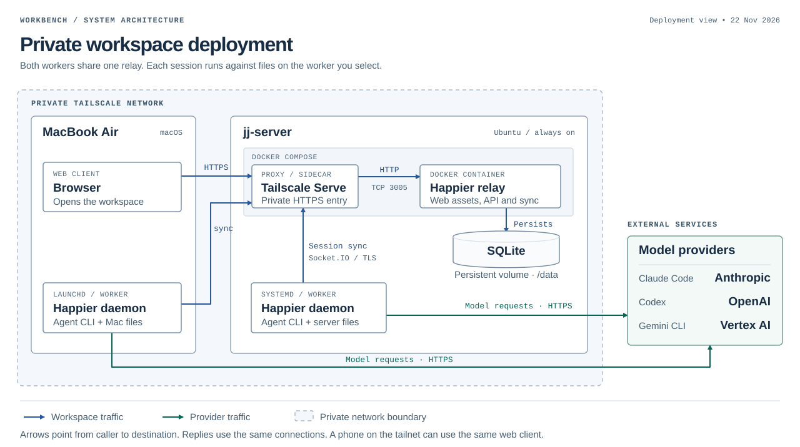

# Workbench working model

Proposal for the personal pilot. **Keep the current task open while other agents work. At a natural break, show the decisions and drafts that need a person.** The first user is someone running several Claude and Codex sessions while answering colleagues and customers.

## What a workday should feel like

You are writing a proposal. A colleague asks in Slack whether Friday’s delivery is still on track. An agent reads the linked Linear issue and drafts a reply. A second agent can check the date against the issue history. Both runs belong to one piece of work. You continue writing.

If Friday can be confirmed at the next break, the draft waits. If a customer call starts in ten minutes and the agent needs your decision before anyone can answer, Workbench surfaces the decision, the deadline and what depends on it. You can answer, delegate a revision, or defer it. Sending the reply requires approval of the exact text and destination. Afterwards, the proposal is still open where you left it.

## When to ask for attention

| What happened | What Workbench should do |
| --- | --- |
| An agent can take another safe step | Let it continue. Keep progress available in the work thread. |
| A draft is ready, or an agent needs an answer that can wait | Add one item to the review queue. Show the proposed action, its evidence and who is waiting. |
| Waiting until the next review would miss a known deadline or block an explicitly time-critical dependency | Interrupt once. Explain the consequence and give the person a way to defer. |
| A run retries, reconnects or emits more detail | Update the same item. Resolve it when the underlying need disappears. |

The person chooses the review point and can mark work time-critical. An incoming mention or a provider error alone supplies too little evidence to interrupt. A work thread can contain the original request, a lead agent, a reviewer and the resulting decision. The person can reply directly when that is faster.

## First experiment

Start with real Claude and Codex sessions in the web workspace. Happier already derives waiting, failed, running and review states, and tracks when a user wants a session kept in “Needs attention.” Extend those owners with a review view that answers “What decision do you need from me?” Preserve the active draft and cursor when the user opens and closes that view. [Session attention logic](../../apps/ui/sources/sync/domains/session/attention/deriveSessionAttentionState.ts) · [Attention preferences](../../apps/ui/sources/sync/domains/session/organization/attentionStanding.ts)

Try it over five ordinary workdays. At each review break, count the sessions you opened just to check. Record any interruption that could have waited and any decision that surfaced too late. The pilot earns a Slack integration if it reduces status checks without missing a time-sensitive decision. The first connector experiment accepts one selected Slack thread with a linked Linear issue, reads the sources and returns one draft for review. Add delivery after that read-and-draft path works.

## Where the software runs today

The Ubuntu server hosts a Tailscale Serve sidecar and the relay on one Docker Compose network. Serve forwards to the relay on port 3005. The relay serves the fork’s web bundle and persists workspace records on its data volume. The Mac and Ubuntu daemons connect to the private relay and launch agent processes. The chosen host supplies the project files, CLI configuration and provider credentials. Model requests go from that worker to its provider. A server session can continue while the Mac sleeps. A Mac session needs the Mac available.

The web client is the pilot release target. The Mac’s separate local relay is useful for development. Use the server workspace for everyday work, including sessions assigned to the Mac worker. The fork’s custom screens reach desktop and mobile browsers with the web deployment. Installed native clients have their own release cycle. [Server setup](../../workbench/README.md) · [Fork diagram and connection paths](architecture.html)

## How to ship and work with upstream

| Decision | Proposed practice |
| --- | --- |
| Source of truth | Keep the fork on GitHub. Mirror upstream `main` and `dev`. Base extension PRs on the fork’s default branch, `workbench/main`. |
| A new stable release | Integrate stable `main` in a PR. Test the focused picker, start and resume a session, and verify worker reconnection before promoting a revision. |
| An unreleased fix | Backport a narrow fix when a failure is reproducible in the pilot or before enabling a workflow with a known permission issue. Link the upstream commit, check its dependencies and test the affected component. |
| Deployment | Build web changes from the reviewed revision. Stage the relay image, then switch it while preserving the existing volume. Verify the served revision and both worker heartbeats. CLI fixes require a worker build or installation on each affected host. |
| Contributions | Offer general runtime and reliability fixes upstream. Keep personal attention rules, experiments and model preferences on the fork while they are being tested. |

Keep **Workbench** as the pilot name and credit Happier. Revisit the public name after people outside the pilot independently choose this workflow and can say what they would miss. Until then, branding changes add release work across web, CLI and native clients without testing the product promise.
